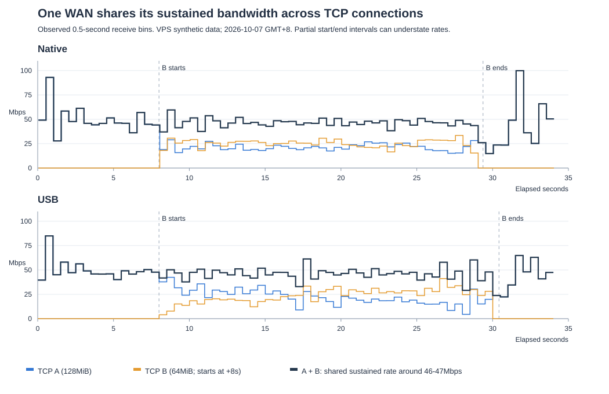

# VPS 单连接聚合限量实测

测试时间：2026-10-06 23:17–23:36，GMT+8。用户提供 VPS 并授权测试，随后明确总流量上限为 3GB。本文不保存 SSH 密码、临时密钥或测试 URL 令牌。

**23:43–23:57 后续对照更新：路由器现有内核实际已支持并启用 MPTCP，无需刷机。MPTCP＋测试发送 socket BBR 在路由器本机达到 131.04 Mbps；Mac 直接 LAN 转发配合测试 socket 缓冲调整/TCP_NODELAY 达到 116.93 Mbps。以下首轮 UDP 结果保留为历史对照，当前方案优先改为 MPTCP TCP 代理。自首次测试起 VPS 网卡累计收发增加约 2.262GB，仍低于总计 3GB 授权。**

**最新更新（2026-10-07 01:07）：总额度已提高到 8GB，可观测累计约 7.822GB。Native/USB 的错峰双 TCP 对照显示，同一路增加新连接后合计仍约 46–47Mbps，更支持按每路会话/IP/路径共享持续容量，未证实每条长 TCP 各有独立 50Mbps 配额。优化长样本仍存在停顿，没有稳定突破此前的 125–131Mbps；有线 IPv6 到同一测速站比 IPv4 快，但这台 VPS 没有公网 IPv6。全部临时配置已恢复，详见末节。**

## 结论与边界

- 用户说明 VPS 上行额度为 200 Mbps；本轮没有核实运营商限速配置。若该限制成立，经此 VPS 的下行聚合无法达到 300 Mbps，且应用吞吐还要扣除协议开销。
- 三路普通 TCP 并行下载整轮平均约 139.65 Mbps。它证明多连接同时下载容量，不代表单连接聚合速度。
- Glorytun 0.3.3 三路径、CUBIC 测试连接仅约 13.06 Mbps，并在 40 秒截止时未下载完成。单 Native 隧道对照约 37.17 Mbps。
- 仅对测试发送 socket 设置 BBR 后，三路径单 TCP 下载约 82.30 Mbps。三个 WAN 接收计数均显著增加，证明该连接使用多个出口；该样本仅 64 MiB、约 6.52 秒，不能作为持续吞吐上限或长期稳定性证明。
- Mac 通过 SSH 本地转发进入该聚合隧道，单 TCP 下载约 58.32 Mbps。此项增加了 Mac 到路由器的 SSH 加密转发，不能与直接 LAN 路由等同。
- 没有可用的 115 CDN 测试链接，本轮未验证 VPS 到 115 的单连接吞吐、签名链接出口限制或完整 HTTPS 播放路径。不能宣称已实现 115 单连接加速。
- 无线两路仍连接同一 AP，不能据此排除共享无线容量或共同故障。BBR 对照明显改善结果，但没有隔离证明丢包、乱序、队列、AP 或运营商中的具体原因。

## 环境与方法

VPS：Debian 12，KVM，4 vCPU、约 4GB RAM，Linux 6.1.0-10-amd64。MPTCP 已启用，存在 TUN 设备；测试前只监听 SSH，nftables 规则集为空。公网地址由上游映射到服务器私网接口。三路 UDP 小包回显全部成功，Native/USB/wired 各三包 RTT 约 25–26/24/23ms；小包可达性不代表大包无损或满速能力。

HTTP 基准使用临时 Python 服务、随机字节块、禁止压缩和缓存、客户端丢弃内容。服务具有累计字节硬限制及自动退出时间；客户端不自动重试并设置截止时间。没有读取用户文件，也没有提供开放代理。先下载总计 80 MiB 的短样本，用户将预算扩大到 3GB 后再延长样本并进行真实隧道测试。

Glorytun 使用官方 v0.3.3 同版本 ARM64/x86_64 静态程序，仅放在两端 `/tmp`。加密为 ChaCha20-Poly1305；专用临时 TUN 设备 `gt115test`，隧道 IPv4 为 `10.77.0.1`/`10.77.0.2`，测试 MTU 为 1400。三个路径各设置 RX 48 Mbps、TX 10 Mbps；RX 合计配置值为 144 Mbps，因此本轮隧道测试也没有尝试证明 200 Mbps 上限。服务器单一地址下旧路径状态可能暂留，不能据此当作新增校园认证会话。

临时策略只匹配路由器当前三个 WAN 源 IPv4 到 VPS 公网 IPv4，使用事先确认空闲的表 201–203、优先级 80–82。现有表 103、pref 103、`iif br-lan lookup 103` 未替换；不接管 LAN 流量。测试脚本有退出清理及 90 秒终止守卫，curl 有更短截止时间。路由器无 `timeout` 命令，第一次调用在执行测试脚本前退出；随后使用 BusyBox shell 守卫。一次单路径准备检查碰到 VPS 五分钟自动退出，ping 失败后自动清理，未产生 HTTP 吞吐样本；重启临时 VPS 隧道后才得到有效单路径对照。

## 实测数据

速度由 curl 接收字节率换算为十进制 Mbps，包含连接建立和样本传输时间。

| 测试 | 样本与截止 | 结果 Mbps | 说明 |
| --- | --- | ---: | --- |
| Native 直达 VPS | 96 MiB | 50.35 | 完整下载，15.99 秒 |
| USB 直达 VPS | 96 MiB | 48.84 | 完整下载，16.49 秒 |
| 有线直达 VPS | 96 MiB / 40 秒 | 8.35 | 仅接收 41,749,872 字节，超时，异常样本 |
| 三路同时直达 VPS | 各 96 MiB | 139.65 合计 | 整轮 17.30 秒；Native/USB/wired 分别 48.44/46.57/49.44 |
| Native 单路径 UDP 隧道，CUBIC | 64 MiB | 37.17 | 完整下载，14.44 秒 |
| 三路径 UDP 隧道，CUBIC | 256 MiB / 40 秒 | 13.06 | 接收 65,310,600 字节后截止 |
| 三路径 UDP 隧道，测试 socket BBR | 64 MiB | 82.30 | 完整下载，6.52 秒；三路 RX 分别增加约 27.03/27.02/27.49MB |
| Mac → SSH 转发 → 三路径隧道，BBR | 64 MiB | 58.32 | 完整下载，9.21 秒；含额外 SSH 开销 |

最初 12 MiB 单路短测 Native/USB/wired 为 70.73/66.63/55.32 Mbps；Mac en0 直达 VPS 的 8 MiB 短测为 67.18 Mbps。短测与延长样本不一致，不能用最初瞬时结果保证持续速度。有线异常后并行样本恢复到约 49 Mbps，原因没有确认。

CPU `/proc/stat` 对照在 6.52 秒 BBR 聚合期间全核合计忙碌约 26%，未见全机 CPU 饱和；不排除单线程、包处理或其他性能限制。初始隧道 ping 因建立/协商显示约 0.25–2.25 秒延迟，不是已建立路径 RTT；路径探测约 22–31ms，测试中 Native 曾升至约 85ms。

## 流量与清理

VPS 网卡计数从 TX/RX 20,570/18,054 字节增长到 954,316,602/30,424,886 字节；合计增加 **984,702,864 字节，约 0.985GB**。包含协议、重传和该接口其他流量，未扣除少量 SSH 管理流量。官方程序下载在 Mac 上发生、量级低于数 MB，整体明显低于授权的 3GB。本轮未为了耗完预算继续测速。

路由器仅为测试安装匹配当前内核的 kmod-tun；结束后卸载模块并移除软件包，安装包清单与测试前逐字一致。VPS 临时加载 tcp_bbr，只在测试 socket 上使用；清理后模块已移除，可用拥塞控制恢复 reno/cubic，默认一直保持 cubic。

已关闭全部临时 HTTP/UDP 服务和两端隧道，取消 Mac SSH 本地转发，删除远端测试程序、脚本和密钥。VPS 最终只监听原 SSH 22 端口、无测试 TUN、nftables 仍为空。路由器专用规则及路由已清理，表 103 三路 1:1:1、pref 103 iif br-lan 保留。网络/无线/防火墙/系统/校园认证配置和三份持久会话记录的八项 SHA-256 校验通过；未发起校园登录/注销、无线扫描/重关联或修改夜间预算。

23:36:42 验收：Native/USB/wired 各自公网 HTTPS 返回 200，约 198/163/135ms。测试前校验与包清单留在路由器 `/root/scut-vps-test-backup-20261006`，权限 700，不含下载到本机的凭据。没有保留生产聚合部署、提交或推送。

协议参考：[Glorytun 官方项目](https://github.com/angt/glorytun)、[官方配置说明](https://github.com/angt/glorytun/wiki/Mini-HowTo)。本文结果来自实际网络测试，不是这些文档的性能承诺。

## 后续 MPTCP 与 Mac 直接 LAN 对照（23:43–23:57）

用户指出 82 Mbps 未触及 VPS 的 200 Mbps 上限，要求继续解释和解决低速。核对发现路由器 `net.mptcp.enabled=1`，内核路径管理器启用，完整 iproute2 支持 MPTCP 命令；首轮未先核对此能力，过早选择 UDP 聚合路线。两端初始 MPTCP 端点为空、额外子连接上限为 2，不需要修改内核或全局上限。

使用自行编译的限量测试接收器/一次性 LAN 转发程序（ARM64 musl 静态），VPS Python 服务通过 `socket(AF_INET, SOCK_STREAM, IPPROTO_MPTCP=262)` 监听。仅发送合成数据，非生产代理；请求受随机令牌、累计字节上限和期限约束。三路测试仍使用先前的源地址到 VPS 专用规则；临时添加 USB、有线两个 `subflow` 端点，初始连接走 Native。LAN 表 103 保持原状。脚本有 180 秒退出守卫和清理，接收器/转发程序另有 55/60 秒期限。

MPTCP INFO 的 additional_subflows=2、flags=2（remote key，非 fallback），VPS `ss -Mni` 和各子连接地址共同确认初始加额外两条，共三条 TCP 子连接。最初测试接收器对 newer total 字段的偏移显示错误为 0；后续已修正，Mac 转发程序实际输出 total=3。不能把旧显示中的 0 解读为退回普通 TCP。

| 测试 | 样本 | Mbps | 结果 |
| --- | --- | ---: | --- |
| 普通 TCP Native，CUBIC | 64 MiB | 51.98 | 10.33 秒，完整 |
| 三路径 MPTCP，CUBIC | 256 MiB | 57.82 | 37.14 秒，完整，三条子连接 |
| 三路径 MPTCP，BBR | 256 MiB | **131.04** | 16.39 秒，完整，三条子连接 |
| Native 同一路两 TCP 合计，CUBIC | 两个 32 MiB | 48.63 | 整轮 11.04 秒 |
| USB 同一路两 TCP 合计，CUBIC | 两个 32 MiB | 47.43 | 整轮 11.32 秒 |
| 有线同一路两 TCP 合计，CUBIC | 两个 32 MiB | 17.38 | 整轮 30.89 秒，单条约 46.21/8.69，明显不均衡 |
| Mac → LAN 一次性转发 → MPTCP，BBR，默认缓冲 | 256 MiB | 46.28 | 46.40 秒，完整，无 SSH |
| 同上，调整测试 socket 缓冲和 TCP_NODELAY | 128 MiB | **116.93** | 9.18 秒，完整，无 SSH |

最后一项仅对测试连接设置：VPS `SO_SNDBUFFORCE` 参数 4 MiB，路由器 MPTCP `SO_RCVBUFFORCE` 参数 4 MiB（Linux 实际 socket 缓冲记账会加倍）；路由器 LAN TCP 开启 TCP_NODELAY；Mac 接收缓冲请求 1 MiB并显式绑定 en0 的当前 IPv4。没有修改全局 tcp_rmem/tcp_wmem/net.core.*，没有修改 Mac 系统代理或 TUN。Mac 到路由器路由确认 en0、千兆全双工。本组改动一起应用，未单独隔离哪一个参数贡献了多少提升，且网络本身有波动，不能把差异唯一归因于 Nagle 或缓冲。

VPS 子连接采样直接观察到 TCP 重传和重排序事件。有线一次 BBR 子连接快照 bytes_sent≈47.40MB、bytes_retrans≈1.66MB，说明这条路径并非无损；不能据此反推整个校园网络固定丢包率。MPTCP 重排序在内核重组，不会要求 CDN 支持 MPTCP。CUBIC/BBR 的巨大差异支持继续使用 BBR 做 TCP 聚合，但并未精确隔离中间设备/链路造成的根因。

目前可证明的改进：现有硬件上真实单流路由器 131M、Mac 117M，比首轮 UDP 方案快，接近当时普通并行约 140M。两无线的双 TCP 合计仍约 50M，未见通过多开同一出口连接获得 100M。不能断言账号永久限速 50M，也不能把 140M 当作所有目的地址/时段的容量上限；要到 200/300M，仍需核实各路到目标出口的真实容量及有线波动。VPS 200M 上限并不是首轮 82M 的解释。

### 下一版实施路线

优先使用具备 MPTCP 支持的 TCP 加密代理，例如 Shadowsocks-Rust 的 `mptcp` 配置（官方源码已核对），两端启用 MPTCP、VPS 测试过的 BBR，沿用三个源地址到 VPS 的路由和 USB/有线 subflow。Mac 应用使用 LAN 代理，或后续另行实现选择性 TCP 透明代理。保留校园认证事务、夜间守卫和原表 103；不要将外层隧道绑定成只允许 Native 一个设备，也不要套 SSH 作为正常下载数据通道。

这只是经实测支持的下一版路线：本轮一次性转发程序没有加密/访问控制的生产设计，不得当作常驻开放代理部署。正式代理的加密开销、115 单连接下载、有效 URL 出口限制、重连与长期稳定性仍待验收。本轮没有留下正式代理服务。

清理及验收：两临时 MPTCP 端点、三专用规则/路由、LAN 转发监听和远端测试文件已删除；两端 endpoint 再次为空、limits 仍为 add_addr_accepted=0/subflows=2。VPS 服务关闭、BBR 模块卸载，默认及可用拥塞控制恢复初始状态，nftables 未改动、仅 SSH22 监听。八项路由器配置/会话哈希和软件包清单仍匹配首轮基线；三路 HTTPS200，约 311/336/279ms。

VPS 最终 TX/RX=2,198,717,128/63,532,474 字节；减去首次基线合计 38,624 字节，**全程累计增加 2,262,210,978 字节（2.262GB）**。没有按新一轮重新获得 3GB 额度，也没有使用完剩余额度。未提交/推送。

参考：[Linux MPTCP 设置](https://www.mptcp.dev/setup.html)、[路径管理与子连接](https://www.mptcp.dev/pm.html)、[MPTCP 信息接口](https://www.mptcp.dev/mptcp-info.html)、[Shadowsocks-Rust 配置源码](https://github.com/shadowsocks/shadowsocks-rust/blob/master/crates/shadowsocks-service/src/config.rs)。这些来源支持配置机制，吞吐数据来自本轮实测。

## 三路 MPTCP 发送节奏对照（2026-10-07 00:03–00:14，GMT+8）

用户要求继续提升三路聚合单连接，并把全程累计流量上限从 3GB 改为 **5GB**。沿用此前已用的 2.262GB，没有重置计数。先只读核对：三路地址/网关及表 103 未变；两无线仍在同一 AP，Native TX/RX=458.8/573.5、USB=573.5/573.5 Mbps；有线物理速率仍是 100Mbps。VPS 默认 CUBIC，MPTCP 端点为空，网卡 MTU=1450，原队列为 mq + 四个默认 fq_codel。

再次建立仅指向 VPS 的临时源路由及 USB/有线 subflow；未修改原表 103、MPTCP 上限、无线或认证。限量合成数据服务初始累计载荷硬限 2GiB，20 分钟自动退出，接收器/一次性 LAN 转发另有 55/60 秒期限；路由测试有 20 分钟清理守卫。最后依据实测网卡剩余额度，另开一次累计载荷硬限 256MiB、3 分钟退出的复测服务。所有接收数据直接丢弃，不含 115 文件或生产加密代理。

本轮 socket 默认参数：VPS SO_SNDBUFFORCE=4MiB，路由器 SO_RCVBUFFORCE=4MiB（Linux 实际记账加倍），LAN TCP_NODELAY，Mac SO_RCVBUF 请求 1MiB，Mac 显式绑定 en0 的 IPv4。拥塞控制仅对测试发送 socket 设置 BBR。下表是接收端完整字节数除以含建连的总时间，均为十进制 Mbps；每条 MPTCP 测试均确认 flags=remote_key、非 fallback，三路 total=3，双路 total=2。

| 测试 | 载荷 | 秒 | Mbps |
| --- | --- | ---: | ---: |
| Native 普通 TCP BBR | 64MiB | 10.685 | 50.245 |
| USB 普通 TCP BBR | 64MiB | 11.036 | 48.645 |
| 有线普通 TCP BBR | 64MiB | 10.628 | 50.515 |
| 三路同时普通 TCP BBR | 各 128MiB | 22.25 整轮 | **144.8 合计** |
| 三路 MPTCP，路由器接收 4MiB 参数 | 256MiB | 17.920 | 119.838 |
| 三路 MPTCP，接收参数加到 8MiB | 256MiB | 21.453 | 100.100 |
| 双无线 MPTCP，接收参数 8MiB | 128MiB | 15.947 | 67.334 |
| Mac 单连接，原 VPS mq/fq_codel | 128MiB | 10.697 | 100.378 |
| Mac 单连接，原 VPS mq/fq_codel | 256MiB | 19.150 | 112.140 |
| Mac 单连接，VPS FQ 每流 50Mbps | 256MiB | 16.408 | **130.881** |
| 同参数短样本复测 | 64MiB | 4.974 | 107.944 |
| Mac 单连接，VPS FQ 每流 32Gbps，近似不限速 | 128MiB | 14.020 | 76.584 |
| Mac 单连接，恢复 FQ 每流 50Mbps 后复测 | 256MiB | 17.140 | **125.293** |

三路同时普通 TCP 的各路均速分别为 48.576/48.640/48.262Mbps。样本支持当前目的地址、时段下合计约 145Mbps；不能推断校园账号永久限速或其他 CDN 的上限。加大接收缓冲、去掉有线都未改善本轮结果，保留三路和 4MiB 参数。

### 有效改进：限制子连接突发，而非限制整个隧道为 50Mbps

VPS 原队列的 BBR 快照出现过估计带宽超过单路实测容量、明显重传及短时零发送队列停顿。普通 TCP 并行期间，三个连接快照分别出现约 6.35/6.27/3.41MB 的 bytes_retrans；这不是全程固定丢包率，也没有定位丢包设备。

临时把 VPS eth0 的根队列替换为 FQ：

```sh
tc qdisc replace dev eth0 root fq maxrate 50mbit quantum 1464 initial_quantum 1464
```

这里 maxrate 作用于每个 TCP 流。三条 MPTCP 子连接分别控速，合计仍可接近 150Mbps。quantum/initial_quantum 限制调度突发；本轮将这些参数一起应用，没有隔离每个参数的独立贡献。FQ 本身也承担发送 pacing，因此不能把结果全部归因于数字 50。

第一次 256MiB 测试的中段，Native/USB/有线 bytes_sent 约 60.51/56.70/57.28MB，bytes_retrans 分别为未显示（0）/1370/未显示（0）；复测中段也仅 USB 出现 1370 字节重传。FQ 队列没有观察到自身丢包，三条连接受 pacing 节奏约束。重排序事件仍存在，不能宣称路径已无乱序。

本轮两个较长 Mac 样本 125.3/130.9Mbps，较此前 116.9Mbps 最好 Mac 样本提升约 7–12%，也高于本轮原队列 100–112Mbps。64MiB 短样本只有 107.9Mbps，说明建连/起速或网络波动仍影响结果；尚不能保证始终 130Mbps。近似不限速 FQ 的 128MiB 样本为 76.6Mbps，支持继续控制发送节奏，但样本长度和网络时序不同，未构成长期或严格随机对照证明。

临时切换有两次命令参数问题：最初对 handle=0 的 mq 子队列替换失败，原队列未变，随后 256MiB/112.14Mbps 归入原队列；`maxrate unlimited` 也被当前 tc 拒绝，对应 64MiB/107.94Mbps 仍属于 50Mbps 参数。后来明确设为 32gbit 并核对实际队列后才做近似不限速样本。没有把失败命令后的样本误归类为参数已生效。

### 实施建议与验证边界

现有证据支持下一版使用三路 MPTCP TCP 加密代理、VPS 测试过的 BBR、4MiB 发送/接收缓冲，以及按三条实际路径容量控制子连接发送节奏。本轮 VPS 内核 6.1 的 MPTCP socket 不支持 SO_MAX_PACING_RATE，因此使用 FQ 队列验证。正式实施应只匹配聚合代理的 TCP 出站流，结合动态地址/链路健康管理，避免直接把测试用的全网卡每流 50Mbps 设置作为通用生产配置。默认 mq/fq_codel 的恢复方式必须保存并验证。

当前约 145Mbps 的普通并行结果已给出该路径的实测参照，约 125–131Mbps 的 Mac 单连接仍有约 10–15% 聚合开销/利用损失。要继续接近 200Mbps，首先需要提高或改变 VPS 到三路的实际可用容量；不能仅靠继续放大缓冲或标称无线协商速率保证达到。200Mbps VPS 也无法持续转发 300Mbps 到本机。115 CDN 到 VPS 的入站速度、115 URL 出口约束、生产加密开销、长期稳定性尚未测试。

### 清理、额度及验收

00:14:09–00:14:10 已停止所有测试服务和守卫，删除两端临时令牌/服务/路由脚本、远端程序和监听。VPS `tc qdisc del dev eth0 root` 恢复默认 mq + 四个 fq_codel，文本与保存的初始队列逐字比较通过；卸载临时 tcp_bbr、sch_fq，默认/可用拥塞控制恢复 cubic / reno cubic，nftables 仍为空，仅 SSH22 监听。

路由器 MPTCP 端点再次为空，limits 仍为 0 accepted / 2 extra；pref80–82、表201–203测试路由清空，pref103 iif br-lan、表103三路1:1:1保留。八项原配置/会话哈希和初始软件包清单通过。Native/USB/有线绑定接口 HTTPS HEAD 均 200，约 232/250/201ms。没有校园登录/注销、无线扫描/重关联、生产服务重启、系统全局缓冲修改或夜间额度修改。

删除远端测试文件后的 VPS TX/RX=4,776,438,614/122,718,061 字节；减首次基线合计 38,624，**全程累计 4,899,118,051 字节（4.899GB）**，含该网卡协议、重传和 SSH 等流量。另有早先 Mac 的数 MB 程序下载，整体仍留有约 100MB 余量并已停止载荷测试。所有优化均为临时测试，当前未保留生产聚合部署；本地记录未提交/推送。

机制参考：[Linux MPTCP 内核文档](https://docs.kernel.org/networking/mptcp.html)、[BBR 官方 FAQ 的 socket 状态观测](https://github.com/google/bbr/blob/master/Documentation/bbr-faq.md)。性能数字来自上述实际采样。

## 持续 50Mbps 假设：错峰双连接与后续对照（00:46–01:07，GMT+8）

用户补充不同目的站的观察：单校园连接刚开始约 10MB/s，持续后约 6MB/s；三路刚开始约 26MB/s，持续后约 18MB/s。按十进制换算，6/18MB/s 分别为 48/144Mbps，与前面实测单路约 50Mbps、三路约 145Mbps吻合。用户把累计额度再增加 3GB，现为 **全程 8GB**，继续计入之前的约 4.899GB。后来明确确认本轮期间没有其它大流量任务。

### 新 TCP 能否重新获得一份 50Mbps

每次仅测试一条 WAN：TCP A 下载 128MiB；8 秒后同源 IP、同目的 VPS 再启动 TCP B 下载 64MiB。接收器按路由器同一单调时钟的绝对半秒边界记录接收字节，两条流在同一时间窗求和。发送端 BBR，原 VPS mq/fq_codel；没有在这一组主动设置 50Mbps 队列上限。

| WAN | B 启动前 A | 两条同时的 A | 两条同时的 B | 同时合计 | B 结束后的 A |
| --- | ---: | ---: | ---: | ---: | ---: |
| Native | 46.389 | 21.354 | 25.205 | **46.559** | 46.203 |
| USB | 46.692 | 21.225 | 24.885 | **46.111** | 50.243 |

单位均为 Mbps。前窗为 A 开始后约 3–8 秒，重叠窗为约 10–28/29 秒，后窗为 B 完成后、A 完成前的短窗；第一/最后非完整半秒不参与。Native A/B 完成分别为 34.288/21.369 秒；USB 为 34.122/22.422 秒。冷启动半秒接收峰值 Native≈92.99、USB≈84.91Mbps，随后回落，不能拿半秒峰值作为持续容量。



[半秒采样 CSV](assets/wan-shared-rate-20261007.csv) 保存归一化时间和接收率，不含认证信息或下载 URL。

这组结果对“每条 TCP 独立限 50Mbps、重新建连接即可再拿一份”不支持，更支持同一路的校园会话/源 IP/路径共享约 50Mbps 持续容量。结合用户多个目的站出现同样现象，校园出口的会话/IP 流控是较有解释力的假设。但本组仍只在同一个 VPS 目的地址上控制对照，不能仅凭这些数据定位到学校哪台设备，或排除目的地址相关的路径策略。

允许初始突发、持续后收敛以及超速时重传，符合令牌桶 policing 的行为：空闲时积攒突发额度，耗尽后按补充速率放行，超额可能被丢弃。也可能存在整形/其他策略，不能认定已读取了真实限速配置。若持续配额为 R、有限突发额度为 B，长时间平均上限为 R+B/T；不断暂停或重连并不自动增加长期平均容量，等待也应计入时间。暂未测出 B 的大小或准确补充时间。

### 不同目的站和 IPv6 对照

有线当前具有公网 IPv6 及源前缀默认路由，两个无线没有公网 IPv6；VPS 没有公网 IPv6 或 IPv6 默认路由。只读检查未修改 IPv6 配置。Cloudflare 官方测速端点按请求明确生成最多 64MiB，各请求设连接 5 秒/总共 25 秒上限、64MiB 文件大小上限和 identity 编码，数据丢弃，无重试：

| 连接 | 实际接收 | 秒 | 平均 Mbps | 结果 |
| --- | ---: | ---: | ---: | --- |
| Native IPv4 | 45,381,824B | 25.006 | 14.520 | 超时、不完整；另一个目的路径更慢 |
| 有线 IPv4 | 67,108,864B | 11.498 | **46.693** | 完整，HTTP200 |
| 有线 IPv6 | 67,108,864B | 7.399 | **72.556** | 完整，HTTP200 |

有线的 IPv4/IPv6均连接 Cloudflare HKG，分别观测到 IPv4 经 AS4538、IPv6经 AS23910；目的 IP 和路由不同。IPv6 样本更快，说明替代路径值得验证，但不能证明所有 IPv6 不限速，或保证 115/另一台 VPS 同速。有线物理仍为 100Mbps。现有 VPS 没有 IPv6，因此这一容量不能直接纳入它的 MPTCP 通道。

### 按每路总量控速、拥塞控制和发送方式

按每个 TCP 子连接 50Mbps 控速，在多个 MPTCP 下载并存时，多个子连接仍可能共同超出该 WAN 的约 50Mbps。为验证这种优化方向，VPS 临时使用 HTB 根队列、每路独立 class，匹配测试服务 TCP 源端口和当前三个 NAT 出口地址，各 class 总量 51Mbps，子队列为 FQ 每流 51Mbps、quantum/initial_quantum=1464，HTB burst/cburst=16/8KiB。普通非测试流量进入另一个 class；所有规则仅为临时实验，结束恢复原队列。没有修改系统默认 CUBIC，BBR/CUBIC仅用于测试 socket。

| Mac 单连接测试 | 载荷 | 秒 | 整轮 Mbps | 观测 |
| --- | ---: | ---: | ---: | --- |
| FQ 每流50，BBR，原带 timeout 的发送方式 | 256MiB | 17.671 | 121.523 | 正常段约140，但10–14秒出现停顿 |
| FQ 每流50，CUBIC，同发送方式 | 256MiB | 16.276 | **131.945** | 约2–16秒样本约139–141 |
| 每路总量51＋FQ，BBR，同发送方式 | 512MiB | 36.670 | 117.124 | 正常段约140–145，约11秒/22–25秒等有停顿 |
| 相同51队列，CUBIC，同发送方式 | 512MiB | 40.182 | 106.888 | 约2–9秒起步停顿，之后大多约140–143，尾段也波动 |
| FQ 每流50，CUBIC，改阻塞发送＋SO_SNDTIMEO | 384MiB | 32.045 | 100.523 | 大多约100–110，没有改善 |

所有测试完整接收，转发程序每次确认 MPTCP total=3。FQ 每流50下另有两个同时 MPTCP 接收器，各64MiB，整轮8.42秒约127.6Mbps合计，个别流完成时间明显不均衡；未对 HTB 再做同长度多下载验收。

这一轮没有得到可重复、稳定优于此前 125–131Mbps 的完整长样本，因此不能把 CUBIC、51Mbps HTB 或阻塞发送宣称为新的长期最佳配置。131.945Mbps 相对上轮130.881Mbps差异不足1%，可能是时序波动。正常传输段约140Mbps说明接近路径容量可行，但完整长样本会被停顿拉低。

51Mbps BBR 中段三条 TCP 的重传仅有线约345KB，另两条未显示重传；CUBIC 中段仅有线约16.4KB、另两条未显示，HTB/FQ自身未观察到队列丢包。小重传仍可能触发多路径重组等待，不能以“总重传少”排除 TCP/MPTCP 阻塞。BBR停顿时点与周期探测可能有关，但没有追踪内核状态证实。CUBIC也有长停顿，阻塞方式没有解决，因此应用接口、旧内核 MPTCP 发送/调度和重组行为仍需继续排查，不能指定某个 bug 为根因。

VPS 仍为 Linux6.1.37（6.1.0-10-amd64），远早于路由器6.12.94；本地 APT 缓存只有当前已安装内核候选，未更新缓存/安装或重启。较新、支持公网 IPv6 的受控 VPS是后续对照方向；升级内核是否能消除停顿尚未验证，不应作性能保证。测试后约7秒三路 RX增量很低，无持续大流量背景；没有全程记录其它流量，用户确认本轮没有其他大流量任务。

当前更准确的优化目标：先以每路共享约50Mbps持续容量设计聚合和总量 pacing，争取更稳定地接近140–145Mbps；要明显突破，先验证容量更高的 IPv6/其他路径。已经验证的稳定容量不能由重复新建 TCP、增加线程或短时突发推导到300Mbps。

### 清理与累计额度

01:07:01–01:07:03停止临时服务/守卫，原 VPS mq+四个fq_codel与保存基线逐字一致；卸载 tcp_bbr/sch_fq/sch_htb/cls_u32，恢复 cubic / reno cubic，nft仍为空、仅SSH22。路由器测试端点/专用规则/表201–203清空，原MPTCP limits0/2和pref103 iif br-lan、三路1:1:1保持；八项配置/会话哈希和初始包清单通过。绑定三接口 HTTPS200，约253/212/247ms。远端测试程序、日志、令牌及py_compile缓存均已删除。

删除文件后的VPS TX/RX=7,448,653,109/182,298,509B，减首次基线38,624，累计 **7,630,912,994B**。本轮三个Cloudflare对照的 WAN RX增量分别48,988,487/70,636,666/71,700,106B，另计合计 **191,325,259B**，不混入VPS网卡计数。两者可观测累计 **7,822,238,253B（7.822GB）**，另有早先Mac数MB工具下载及少量管理流量，仍在8GB内，已停止载荷测试。Cloudflare分配了独立保守余量，VPS最后服务另有7.7GB累计网卡停止阈值和384MiB载荷硬限。

未保留常驻聚合/限速服务，未升级/重启VPS，未认证/注销/重关联校园会话，未改变全局缓冲/IPv6/夜间额度，未提交或推送。

机制来源：[Cisco policing 与 shaping 及令牌桶](https://www.cisco.com/c/en/us/support/docs/quality-of-service-qos/qos-policing/19645-policevsshape.html)、[BBR 原论文的 token-bucket policers 与周期探测讨论](https://web.stanford.edu/class/cs244/papers/bbr.pdf)。它们说明可解释这些现象的机制，不证明校园实际配置。搜索学校公开资料未找到确认本用户每会话50Mbps的官方说明。
